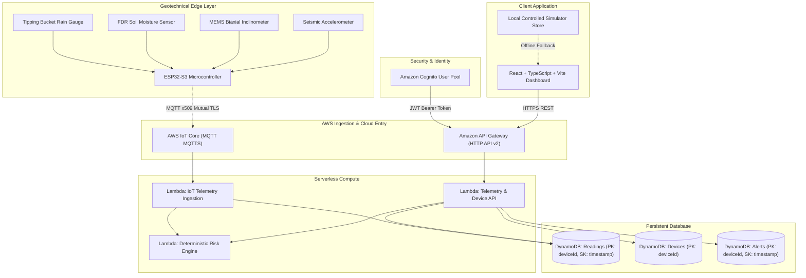

# TerraShield AI — Landslide Early Warning & Life-Safety System

> **Detect Early. Alert Early. Protect Lives.**

[](https://react.dev/)
[](https://www.typescriptlang.org/)
[](https://vitejs.dev/)
[](https://aws.amazon.com/serverless/sam/)
[](LICENSE)

---

## 1. Project Overview

**TerraShield AI** is an environmental geotechnical early warning and life-safety system engineered to forecast, monitor, and alert against catastrophic rainfall-induced landslides and debris flows. 

Unlike simplistic single-sensor dashboards, TerraShield AI continuously correlates **hydrological load** (peak precipitation rate & antecedent 24-hour cumulative rain) with sub-surface **pore-water pressure** (volumetric soil moisture saturation % VWC) and early-stage **kinematic slope deformation** (MEMS biaxial inclinometer tilt creep and seismic vibration PPA).

```
   [Hydrological Load]          [Pore Saturation]           [Surface Kinematics]
      Rainfall Rate        +      Soil Moisture       +       Ground Inclinometer
       (Peak & 24h)               (% VWC Saturation)              (Biaxial Tilt °)
            │                            │                               │
            └────────────────────────────┼───────────────────────────────┘
                                         ▼
                   [Deterministic Geotechnical Rule Engine]
                                         │
                                         ▼
                    [Life-Safety Early Warning Alerts]
```

> **MANDATORY LIFE-SAFETY DIRECTIVE:**  
> TerraShield AI is an environmental early warning and research platform. All demonstration telemetry and simulated thresholds are provided strictly for technical evaluation. In extreme weather or geological instability events, always adhere directly to evacuation orders and warnings issued by official government disaster management authorities (NDMA, USGS, Civil Defense, BMKG). No single sensor or algorithm can guarantee prediction of all slope failures.

---

## 2. System Architecture

The application is built on an AWS Serverless architecture designed for least-privilege security, high telemetry ingestion throughput, and sub-second deterministic hazard scoring.



---

## 3. Technology Stack

- **Frontend:**
  - React 19 + TypeScript + Vite 8
  - Vanilla CSS design system with custom CSS properties, deep navy charcoal palette (`#0a0f1d`), glassmorphism, responsive flex/grid layouts, micro-animations
  - Native high-precision SVG time-series charting with scrubbers and threshold lines
  - Lucide React icon system
- **Backend:**
  - Amazon API Gateway HTTP API v2 (CORS, JWT authorizers)
  - AWS Lambda (Node.js 20.x, TypeScript handlers)
  - Deterministic Geotechnical Risk Engine (`RuleEngine-v1.4`)
  - Amazon DynamoDB (Single-table / targeted tables with bounded partition and sort keys)
- **Identity & Security:**
  - Amazon Cognito User Pool & App Client (SRP / password auth, email verification)
  - Least-privilege IAM policies, CORS headers, zero plaintext secrets
- **Edge / IoT Extension:**
  - Industrial ESP32 Arduino/C++ firmware with FreeRTOS
  - AWS IoT Core MQTT ingestion on `terrashield/nodes/{deviceId}/telemetry`
- **Hosting & Infrastructure as Code:**
  - AWS Amplify Hosting (`amplify.yml`)
  - AWS SAM (`template.yaml`)

---

## 4. Controlled Demonstration Mode

To allow testing and evaluation without physical hardware or an active AWS account, TerraShield AI ships with a **controlled demonstration mode**:

1. **Deterministic Test Nodes:**
   - `NODE-SLOPE-01` — Nilgiri Escarpment Node 1 (Western Ghats, KM 42 Ghat Road)
   - `NODE-SLOPE-02` — Chamoli Debris Fan Node 2 (Himalayan Ridge, Upper Alaknanda Valley)
   - `NODE-SLOPE-03` — Cascade Ridge Node 3 (Highway 20 Slope, Pacific Northwest)
   - `NODE-SLOPE-04` — Fraser Cutting Node 4 (Titiwangsa Range, Sector 12)
2. **Explicit Labeling:** Every simulated reading, node, and alert is visibly labeled with a `SIMULATED` badge.
3. **Live Test Injection:** Use the **Inject Test Reading** modal (`FlaskConical` icon) to input custom rainfall, soil moisture, and ground tilt values. The rule engine re-evaluates risk in real time, generates alerts when thresholds breach, and updates dashboard metrics immediately.
4. **Transparent Degradation:** If AWS credentials or backend URLs are unconfigured, the system reports `LOCAL_MOCK` status and persists data safely to local browser storage without crashing or falsely claiming cloud connectivity.

---

## 5. Backend REST API Reference

All endpoints return JSON responses with standard HTTP status codes:

### `GET /health`
- **Description:** Returns service operational status and storage/auth modes without leaking internal credentials.
- **Response (200):**
  ```json
  {
    "status": "healthy",
    "service": "TerraShield AI Backend",
    "version": "1.4.0",
    "storage": { "type": "InMemoryStore", "status": "demo_mode" },
    "auth": { "provider": "LocalDemoAuth", "status": "active" },
    "iot": { "protocol": "MQTT / AWS IoT Core", "status": "hardware_offline_standby" }
  }
  ```

### `GET /readings/latest`
- **Query Params:** `deviceId` *(optional)*
- **Response (200):** Array of latest sensor reading frames per device.

### `GET /readings/history`
- **Query Params:** `deviceId`, `limit` *(default 60)*, `riskLevel` *(optional)*
- **Response (200):** Time-ordered historical telemetry readings.

### `POST /readings`
- **Authentication:** `Bearer <JWT_TOKEN>` *(Required)*
- **Request Body:**
  ```json
  {
    "deviceId": "NODE-SLOPE-01",
    "rainfall": 48.2,
    "rainfall24h": 145.0,
    "soilMoisture": 87.5,
    "tilt": 3.82,
    "vibration": 0.18,
    "temperature": 21.0,
    "humidity": 75.0,
    "source": "SIMULATED"
  }
  ```
- **Response (201):** Returns created reading, evaluated `riskAssessment`, and any generated `alert`.

### `GET /risk/current`
- **Query Params:** `deviceId` *(optional)*
- **Response (200):** Current deterministic geotechnical hazard classifications and factor breakdowns.

### `GET /risk/history`
- **Query Params:** `deviceId`, `limit` *(optional)*
- **Response (200):** Historical risk calculations over time.

### `GET /alerts`
- **Query Params:** `severity` (`CRITICAL`, `WARNING`, `ADVISORY`), `acknowledged` (`true`, `false`)
- **Response (200):** Filtered list of geotechnical hazard alerts.

### `POST /alerts/{id}/acknowledge`
- **Authentication:** `Bearer <JWT_TOKEN>` *(Required)*
- **Request Body:**
  ```json
  {
    "acknowledgedBy": "Dr. Sarah Chen (Chief Geologist)",
    "actionTaken": "Dispatched road closure team and inspected slope crown."
  }
  ```
- **Response (200):** Updated alert record with acknowledgment timestamp and officer audit log.

### `GET /devices`
- **Response (200):** Array of registered telemetry nodes with online, stale, or offline status.

### `POST /devices`
- **Authentication:** `Bearer <JWT_TOKEN>` *(Required)*
- **Request Body:**
  ```json
  {
    "deviceId": "NODE-SLOPE-05",
    "name": "Wayanad Pass Node 5",
    "locationLabel": "Western Ghats, Pass Sector 9B",
    "latitude": 11.6854,
    "longitude": 76.1320,
    "elevation": 950,
    "slopeAngle": 44,
    "soilType": "Lateritic clay",
    "configuredSensors": ["rainfall", "soilMoisture", "tilt", "vibration"]
  }
  ```
- **Response (201):** Newly created device record.

### `GET /devices/{id}`
- **Response (200):** Detailed telemetry station specifications.

---

## 6. Local Setup & Running Instructions

### Prerequisites
- **Node.js:** v18.x or v20+ (tested on Node v24)
- **npm:** v9+ or v11+
- **Git**

### Installation
```powershell
# 1. Clone repository
git clone https://github.com/your-username/TerraShield-AI.git
cd TerraShield-AI

# 2. Install dependencies
npm install

# 3. Copy environment template
cp .env.example .env
```

### Run Tests
```powershell
npm test
```
*Executes all 18 automated tests covering the risk engine, input validation, alert workflows, and backend handlers.*

### Run Local Development Server
```powershell
# Start Vite development dashboard
npm run dev
```
Open [http://localhost:5173](http://localhost:5173) in your browser.

### Build Production Bundle
```powershell
npm run build
```
Generates optimized static bundle in `dist/`.

---

## 7. AWS Cloud Deployment Instructions

### Prerequisites for AWS
- [AWS CLI v2](https://aws.amazon.com/cli/) configured (`aws configure`)
- [AWS SAM CLI](https://docs.aws.amazon.com/serverless-application-model/latest/developerguide/install-sam-cli.html)

### Deploy Backend via AWS SAM (Optional Cloud Mode)
```bash
# 1. Build serverless functions
sam build

# 2. Deploy infrastructure (Cognito, DynamoDB, API Gateway, Lambdas)
sam deploy --guided
```
Follow the interactive prompts:
- Stack Name: `terrashield-ai-production`
- AWS Region: `us-east-1` (or your preferred region)
- Allow SAM CLI to create IAM roles: `Y`
- Confirm changes: `Y`

SAM will output:
- `ApiEndpoint` (e.g. `https://xxxxxx.execute-api.us-east-1.amazonaws.com`)
- `UserPoolId` (e.g. `us-east-1_xxxxxxxxx`)
- `UserPoolClientId` (e.g. `xxxxxxxxxxxxxxxxxxxxxxxxxx`)

### Connect Frontend to AWS (Optional)
If connecting to deployed SAM infrastructure, set environment variables:
```ini
VITE_API_BASE_URL=https://xxxxxx.execute-api.us-east-1.amazonaws.com
VITE_COGNITO_USER_POOL_ID=us-east-1_xxxxxxxxx
VITE_COGNITO_CLIENT_ID=xxxxxxxxxxxxxxxxxxxxxxxxxx
VITE_AWS_REGION=us-east-1
```
*(If unset, TerraShield AI automatically runs in Deterministic Demonstration Mode using local in-browser persistence).*

### Deploy Frontend to AWS Amplify Hosting
1. Repository is hosted at: `https://github.com/altrinejones09/TerraShield-AI` on branch `master`.
2. In the **AWS Amplify Console** (https://console.aws.amazon.com/amplify/):
   - Choose **Host web app** &rarr; select **GitHub**.
   - Select repository `altrinejones09/TerraShield-AI` and branch `master`.
3. Build Settings:
   - Amplify automatically loads `amplify.yml` from the root directory.
   - Build Command: `npm run build`
   - Base directory: `dist`
4. Single-Page Application (SPA) Routing Fallback:
   - In Amplify Console, navigate to **Hosting** &rarr; **Rewrites and redirects**.
   - Add/Verify SPA rewrite rule:
     - **Source address:** `</^[^.]+$|\.(?!(css|gif|ico|jpg|js|png|txt|svg|woff|woff2|ttf|map|json)$)([^.]+$)/>` (or `/<*>`)
     - **Target address:** `/index.html`
     - **Type:** `200 (Rewrite)`
5. Public Access (Evaluation / Judges):
   - Under **App settings** &rarr; **Access control**, verify access is set to **Public** (no password protection).
6. Click **Save and deploy**. Amplify will provision, build, and assign a public `https://master.xxxx.amplifyapp.com` URL.

### Teardown / Resource Cleanup
To prevent unwanted AWS charges after testing:
```bash
sam delete --stack-name terrashield-ai-production
```

---

## 8. Exact Git Commands for Repository Publishing

```powershell
# 1. Initialize git (if not already initialized)
git init

# 2. Stage all implementation files
git add .

# 3. Commit with a production message
git commit -m "feat: complete production-ready TerraShield AI environmental life-safety platform"

# 4. Set main branch
git branch -M main

# 5. Add remote GitHub repository (replace with your repo URL)
git remote add origin https://github.com/your-username/TerraShield-AI.git

# 6. Push to GitHub
git push -u origin main
```

---

## 9. Security & Least Privilege Principles

1. **Zero Committed Secrets:** No AWS access keys, secret keys, or private certificates exist in the codebase.
2. **Backend Token Verification:** Protected API endpoints enforce JWT authorization on the server side.
3. **Least-Privilege IAM:** SAM templates restrict Lambda permissions strictly to the specific DynamoDB table ARNs.
4. **Input Sanitization:** All telemetry frames pass strict numerical range, unit, and implausibility boundaries.
5. **Separation of Concerns:** Real telemetry is separated from simulated demo records via mandatory `source: 'SIMULATED'` tagging.

---

## 10. License

Licensed under the Apache License, Version 2.0. See [LICENSE](LICENSE) for details.
